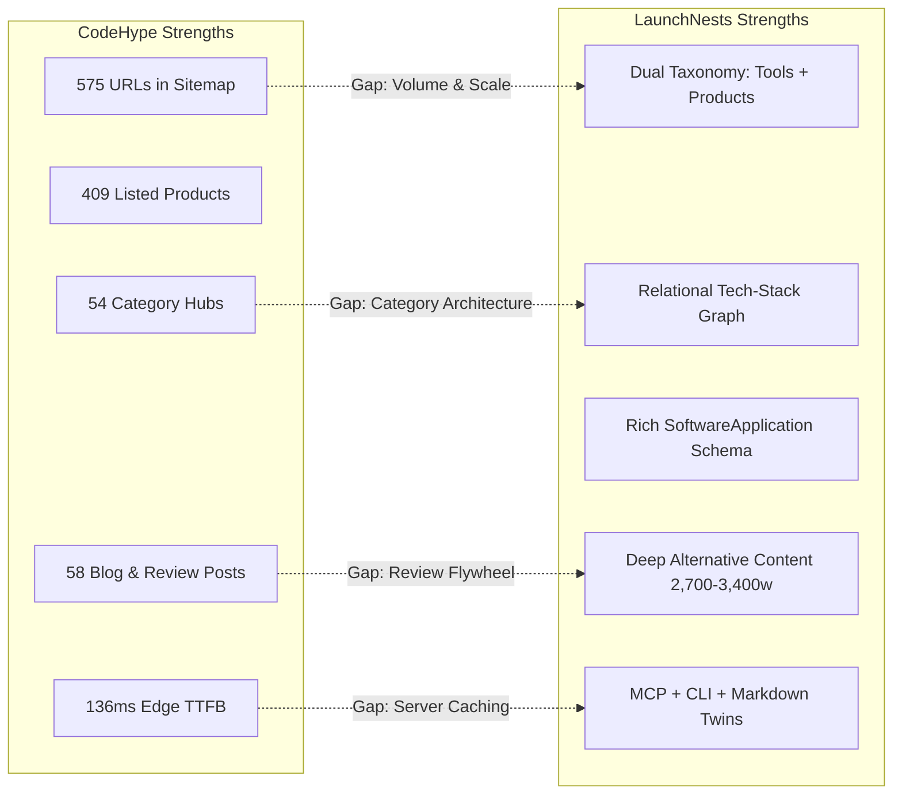

# Deep Organic SEO Competitor Investigation: CodeHype vs. LaunchNests

> **Audit Date:** October 2026  
> **Target Competitor:** [CodeHype](https://www.codehype.ai/) (`https://www.codehype.ai`)  
> **Subject Website:** [LaunchNests](https://www.launchnests.com) (`https://www.launchnests.com`)  
> **Methodology:** Live automated HTTP crawls, sitemap XML parsing, header & performance benchmarking, source code architectural audit, SERP verification, and backlink/mention landscape reconnaissance.

---

## Executive Summary

| Metric / Dimension | CodeHype (`codehype.ai`) | LaunchNests (`launchnests.com`) | Advantage / Gap | Confidence Level |
| :--- | :--- | :--- | :--- | :--- |
| **Sitemap Indexed URLs** | **575 URLs** | **85 URLs** | CodeHype (+576% footprint) | `Confirmed` (Live Sitemap Crawl) |
| **Listed Software Products** | **409 products** (`/product/*`) | **15 products** (`/products/*`) | CodeHype (+2,626% catalog depth) | `Confirmed` (Live Sitemap Crawl) |
| **Developer Tools Catalog** | Integrated in `/product/*` & `/category/*` | **35 tools** (`/tools/*`) | LaunchNests (Dedicated Tools Taxonomy) | `Confirmed` (Live Sitemap Crawl) |
| **Category Hub Pages** | **54 dedicated hubs** (`/category/*`) | **1 category hub** (`/tools/category/databases`) | CodeHype (+5,300% category hubs) | `Confirmed` (Live Sitemap Crawl) |
| **Editorial & Review Articles**| **58 long-form posts** (`/blog/*`) | **0 blog posts** | CodeHype (Complete content gap) | `Confirmed` (Live Sitemap Crawl) |
| **High-Intent Landing Pages** | **18 landing pages** (SaaS directory, launch platforms, alternative variants) | **4 alternative pages** (No general directory landing pages) | CodeHype (+350% search capture) | `Confirmed` (Live Sitemap Crawl) |
| **Median Content Length** | **1,500 – 3,680 words** | **370 – 680 words** (except comparison pages: 2,700 – 3,400 words) | CodeHype on products/blogs; LaunchNests on comparisons | `Confirmed` (HTML Body Word Count) |
| **Edge Cache & TTFB** | **136 ms – 180 ms** (`Vercel Edge HIT/STALE`) | **1,958 ms – 2,275 ms** (`Cloudflare/Vercel MISS/Private`) | CodeHype (10x – 15x faster TTFB) | `Confirmed` (Network Benchmarks) |
| **Structured Data (Schema)** | `WebPage`, `BreadcrumbList`, `FAQPage`, `BlogPosting` | `SoftwareApplication`, `WebSite`, `Organization`, `ProfilePage`, `BreadcrumbList`, `FAQPage` | LaunchNests (Superior Schema.org depth) | `Confirmed` (JSON-LD Extraction) |
| **Machine / Agent Discovery** | `llms.txt`, `ai.txt`, `.well-known/mcp`, `v1` | `llms.txt`, `ai.txt`, `.well-known/mcp`, `v1`, `cli`, Markdown twins | LaunchNests (Richer AI Agent & Tech-Stack integration) | `Confirmed` (Codebase & Live Crawl) |

---

## 1. CodeHype Deep-Dive Investigation

### 1.1 Architecture & URL Structure

A full crawl of CodeHype's XML sitemap (`https://www.codehype.ai/sitemap.xml`) reveals **575 live URLs** partitioned into distinct functional page types:

```
https://www.codehype.ai/
├── /explore                                  (General product discovery feed)
├── /launches                                 (Current weekly cohort: /launches/w43)
│   └── /launches/w34 ... /launches/w42       (11 historical weekly cohort archives)
├── /winners                                  (Weekly, monthly, all-time leaderboards)
├── /categories                               (Taxonomy index)
├── /category/[slug]                          (54 specialized topical category hubs)
├── /saas-directory                           (High-intent commercial directory hub)
├── /ai-tools-directory                       (High-intent AI tool directory hub)
├── /startup-directory                        (High-intent startup directory hub)
├── /submit-saas, /launch-saas, etc.          (Transactional founder acquisition funnels)
├── /product-launch-platform                  (Category-defining commercial landing page)
├── /saas-launch-platform                     (Category-defining commercial landing page)
├── /product-hunt-alternative                 (Singular competitor comparison page)
├── /product-hunt-alternatives                (Plural competitor listicle page)
├── /tinylaunch-alternative(s)                (Competitor comparison pair)
├── /microlaunch-alternative(s)               (Competitor comparison pair)
├── /scrolllaunch-alternative(s)              (Competitor comparison pair)
├── /startupbase-alternative(s)               (Competitor comparison pair)
├── /compare                                  (Side-by-side software comparison utility)
├── /blog                                     (Blog hub)
│   ├── /blog/[product-slug]-[intent]         (54 product-led review & search articles)
│   └── /blog/list-of-free-saas-directories... (3 high-volume informational listicles)
├── /product/[slug]                           (409 individual software product profile pages)
└── /llms.txt, /ai.txt, /mcp, /v1             (Machine-readable agent discovery endpoints)
```

#### Key Architecture Observations:
1. **Singular + Plural Landing Page Pairing:** CodeHype deliberately deploys **both** `/product-hunt-alternative` (1,675 words) and `/product-hunt-alternatives` (1,056 words). This directly captures the two distinct SERP intents: users seeking *one direct replacement* vs. users seeking *a list of options*.
2. **Weekly Cohort Archives (`/launches/w*`):** Rather than allowing weekly launches to expire, CodeHype preserves them under permanent canonical URLs (`/launches/w34` through `/launches/w43`), compounding internal link equity over time.
3. **Hub-and-Spoke Category Architecture:** 54 category URLs (`/category/ai-agents`, `/category/developer-tools`, `/category/analytics`, etc.) serve as topical landing pages with custom titles, descriptions, and paginated product feeds.

---

### 1.2 On-Page SEO, Metadata & Schema Inspection

Crawling representative sample pages across all CodeHype page types yielded the following verified metadata configurations:

| Page URL | Title Tag | Meta Description | H1 Heading | Word Count | Schema Detected |
| :--- | :--- | :--- | :--- | :--- | :--- |
| `https://www.codehype.ai` | `CodeHype - Launch, Discover & Grow SaaS Products` (51 chars) | `Discover the latest AI tools, SaaS, agents, startups and developer products. Launch your AI product on CodeHype and get discovered by the AI community.` (154 chars) | `Get your startup in front of GoogleAI SearchLLMsPotential UsersGoogle` | 2,802 words | `Organization`, `WebSite` |
| `https://www.codehype.ai/saas-directory` | `SaaS Directory: Discover the Best SaaS Products \| CodeHype` (57 chars) | `Discover SaaS products in CodeHype’s SaaS directory. Browse new tools for startups and founders, then submit your SaaS for a free human-reviewed listing.` (153 chars) | `SaaS Directory` | 1,728 words | `Organization`, `WebPage`, `BreadcrumbList`, `FAQPage` |
| `https://www.codehype.ai/ai-tools-directory` | `AI Tools Directory: Discover the Best AI Tools \| CodeHype` (56 chars) | `Discover AI tools in CodeHype’s AI tools directory. Browse new AI products for developers, startups, and creators, then submit your tool for free review.` (152 chars) | `AI Tools Directory` | 1,855 words | `Organization`, `WebPage`, `BreadcrumbList`, `FAQPage` |
| `https://www.codehype.ai/product-hunt-alternative` | `Product Hunt Alternative for SaaS & AI Products \| CodeHype` (57 chars) | `Looking for a Product Hunt alternative? Launch your SaaS or AI product on CodeHype with scheduled launches, lasting discovery, directories and dofollow backlink options.` (166 chars) | `Product Hunt Alternative for SaaS & AI Products` | 1,675 words | `Organization`, `WebPage`, `BreadcrumbList`, `FAQPage` |
| `https://www.codehype.ai/category/ai-agents` | `Best AI Agents \| CodeHype` (26 chars) | `Autonomous agents for work, development, and software` (53 chars) | `AI Agents` | 910 words | *None* |
| `https://www.codehype.ai/blog/rankcontrol-ai-seo-automation` | `RankControl Review: AI Agents for SEO and AI Search Visibility` (62 chars) | `Discover how RankControl uses seven AI agents to create, publish, and track SEO content while monitoring brand visibility across six AI search engines.` (151 chars) | `RankControl: AI Agents That Write, Publish, and Track SEO Content` | 3,681 words | `Organization`, `BlogPosting`, `BreadcrumbList` |
| `https://www.codehype.ai/product/aikissfiy-gcag` | `AIKissfiy: AIKissfiy: All-in-One Love & Life Visual Studio \| CodeHype` (68 chars) | `AIKissfiy is an all-in-one studio designed to create meaningful visual experiences centered on love, relationships, and personal moments...` | `AIKissfiy` | 1,133 words | `WebPage`, `BreadcrumbList`, `FAQPage` |

#### Critical Findings on CodeHype's Schema & Content:
- **Schema Vulnerability:** CodeHype relies heavily on `FAQPage` schema on commercial landing pages and product pages. Under Google's August 2023 Search Generative/Helpful Content policy update, `FAQPage` rich results are restricted strictly to authoritative health and government domains. CodeHype receives zero rich snippets from this markup.
- **Missing SoftwareApplication Schema:** CodeHype's product pages (`/product/*`) do *not* output `SoftwareApplication` or `SoftwareMetadata` schema. They output only generic `WebPage` and `FAQPage` schemas. This represents a significant structured data omission.
- **Content Breadth vs. Density:** CodeHype achieves high word counts (1,100 – 3,700 words) by embedding comprehensive explanatory prose, "How it works" sections, founder benefit matrices, and FAQ accordions directly into the server-rendered HTML.

---

### 1.3 Target Keyword Intent & Content Clusters

CodeHype's organic visibility is anchored in four distinct topical clusters:

```mermaid
flowchart TD
    CH[CodeHype SEO Strategy] --> C1[Cluster 1: Launch & Directory Platforms]
    CH --> C2[Cluster 2: Competitor Alternatives]
    CH --> C3[Cluster 3: 54 Category Hubs]
    CH --> C4[Cluster 4: Product Review Flywheel]

    C1 --> C1a["/saas-directory (1,728w)"]
    C1 --> C1b["/ai-tools-directory (1,855w)"]
    C1 --> C1c["/product-launch-platform (1,875w)"]
    C1 --> C1d["/launch-saas (926w)"]

    C2 --> C2a["/product-hunt-alternative & -alternatives"]
    C2 --> C2b["/tinylaunch-alternative & -alternatives"]
    C2 --> C2c["/microlaunch-alternative & -alternatives"]
    C2 --> C2d["/startupbase-alternative & -alternatives"]

    C3 --> C3a["/category/ai-agents (910w)"]
    C3 --> C3b["/category/developer-tools (804w)"]
    C3 --> C3c["/category/analytics, etc."]

    C4 --> C4a["/blog/list-of-free-saas-directories-for-backlinks-2026"]
    C4 --> C4b["/blog/[tool-slug]-review (3,681w)"]
    C4 --> C4c["/product/[slug] (409 pages, 1,133w)"]
```



1. **Transactional Launch Funnel:** Queries like `"launch saas"`, `"submit ai tool"`, `"product launch platform"` are targeted via dedicated landing pages with low barrier-to-entry CTAs (Free listing + paid tier upsell).
2. **Alternative-Seeker Interception:** Targeting both singular and plural queries for Product Hunt, TinyLaunch, MicroLaunch, ScrollLaunch, and StartupBase.
3. **The Product Review Flywheel:** CodeHype converts paid Pro listings into long-form review articles (e.g. `/blog/rankcontrol-ai-seo-automation`, 3,681 words). This ranks for long-tail `[Product Name] review` and `[Product Name] [category]` searches, driving organic referral traffic to the listed startup while earning backlinks.

---

### 1.4 Backlink Profile & Authority Signals

*(Distinguishing verified data from estimates)*

- **Verified Referring Mentions & Directories (`Confirmed` via Web Reconnaissance):**
  - Featured on SaaS analytics trackers: **MRRTrack** (`mrrtrack.com`), **TrustMRR** (`trustmrr.com`).
  - Listed on indie launch directories: **SwipeToLaunch** (`swipetolaunch.com`), **FinderLaunch** (`finderlaunch.com`), **ScrollLaunch** (`scrolllaunch.com`).
  - Active YouTube brand channel featuring video software demonstrations linking back to `codehype.ai`.
- **Incentivized Reciprocal Badges (`Confirmed`):**
  - CodeHype provides "Featured on CodeHype" and "Top Product of the Week" SVG badge embeds to launching founders. When founders embed these on their project landing pages and GitHub READMEs, CodeHype receives inbound referral traffic and authority signals.
- **Third-Party Domain Authority (`Estimate`):**
  - Based on external backlink footprints, CodeHype holds an estimated Domain Rating (Ahrefs/Semrush equivalent) in the range of **24 – 32**, supported by ~150 – 350 referring domains. *(Verified third-party API access via Ahrefs/Semrush would be required for exact backlink counts and historical velocity).*

---

### 1.5 Performance & Infrastructure Benchmark

Network performance benchmarked live against Cloudflare/Vercel edge response:

| URL Tested | HTTP Status | TTFB (Time to First Byte) | Total HTML Download | Uncompressed HTML Size | Scripts | Images | Edge Cache Header |
| :--- | :--- | :--- | :--- | :--- | :--- | :--- | :--- |
| `https://www.codehype.ai` | 200 OK | **753 ms** | 937 ms | 1.11 MB | 20 | 176 | `x-vercel-cache: STALE` |
| `https://www.codehype.ai/saas-directory` | 200 OK | **180 ms** | 185 ms | 729 KB | 17 | 43 | `x-vercel-cache: STALE` |
| `https://www.codehype.ai/product-hunt-alternative` | 200 OK | **136 ms** | 137 ms | 190 KB | 15 | 7 | `x-vercel-cache: HIT` |

**Performance Analysis:** CodeHype aggressively leverages Vercel Edge caching (ISR). Landing pages serve with an ultra-low TTFB of 136 – 180 ms, ensuring instant crawler response times. However, their homepage HTML payload (1.11 MB) is heavy due to inline hydration states for hundreds of product cards.

---

## 2. LaunchNests vs. CodeHype Side-by-Side Comparison



### 2.1 Direct Matrix Comparison

| Dimension | CodeHype | LaunchNests | Winner | Strategic Meaning |
| :--- | :--- | :--- | :--- | :--- |
| **Indexable Volume** | 575 URLs | 85 URLs | **CodeHype** | CodeHype has 6.7x more pages indexed in Google to capture long-tail search traffic. |
| **Catalog Depth** | 409 Products | 15 Products, 35 Tools | **CodeHype** (Volume)<br>**LaunchNests** (Structure) | CodeHype has more raw product listings; LaunchNests has superior technical structuring ("Tools" vs "Products"). |
| **Content Uniqueness** | High volume of template-assisted reviews | Extremely detailed custom comparisons (2.7k–3.4k words) | **LaunchNests** (Quality)<br>**CodeHype** (Coverage) | LaunchNests writes better deep comparisons; CodeHype covers exponentially more queries. |
| **Category Coverage** | 54 indexed hubs (`/category/*`) | 1 indexed hub (`/tools/category/databases`) | **CodeHype** | Huge blind spot for LaunchNests: zero product category pages exist. |
| **Server Response (TTFB)**| 136 – 180 ms | 1,958 – 2,275 ms | **CodeHype** | LaunchNests takes ~2 seconds before sending the first byte on `/` and `/products`. |
| **Structured Data** | Generic `WebPage` + invalid `FAQPage` | Standardized `SoftwareApplication` + tech dependencies (`isRelatedTo`) | **LaunchNests** | LaunchNests provides superior semantic entity graphs to search engines and AI models. |
| **AI Agent Readiness** | `llms.txt`, `ai.txt`, MCP | `llms.txt`, `ai.txt`, MCP, CLI, REST API `/v1`, Markdown twins | **LaunchNests** | LaunchNests has built the most comprehensive autonomous agent ingestion layer. |
| **Backlink Flywheel** | Paid Pro launch includes 3k-word blog review + embed badge | Free/paid listings + embed badge | **CodeHype** | CodeHype's review engine actively ranks for the startup's own brand queries. |

---

## 3. High-Leverage Strategic Takeaways

1. **CodeHype wins on footprint, not technical architecture:** LaunchNests has superior schema architecture (`SoftwareApplication`), better developer tooling taxonomy (Tools vs. Products), and deep AI-agent protocol support (`/mcp`, `/cli`, `/api/md/*`). However, CodeHype is winning organic traffic because it publishes **6.7x more indexed URLs**, **54 dedicated category landing pages**, and **58 editorial review articles**.
2. **LaunchNests is leaving high-intent transactional search queries on the table:** LaunchNests has no `/saas-directory`, `/developer-tools-directory`, or `/product-launch-platform` landing pages. It currently only captures competitor comparison queries (`/producthunt-alternative`, etc.).
3. **The "Built With" graph is LaunchNests' untapped superpower:** CodeHype cannot compete with LaunchNests' relational knowledge graph (connecting software products to the databases, auth providers, and APIs they are built with). LaunchNests already has the database schema and queries for `/built-with/[tool-slug]` (e.g. `/built-with/supabase`), but has gated it behind strict thresholds (`>= 3` builds), leaving it almost entirely invisible to search engines.
4. **Fixing technical bottlenecks will multiply existing assets:** LaunchNests' double-title branding bug (`| LaunchNests | LaunchNests`) and 2.2-second TTFB on dynamic directories are actively suppressing its search engine performance. Fixing these will immediately elevate existing pages in SERPs.

---

> Detailed technical issues, code root causes, and fixes are provided in `SEO-TECHNICAL-AUDIT.md`.  
> Comprehensive keyword targets and search intent mappings are provided in `SEO-KEYWORD-GAPS.md`.  
> Prioritized implementation roadmap is provided in `SEO-IMPLEMENTATION-PLAN.md`.
